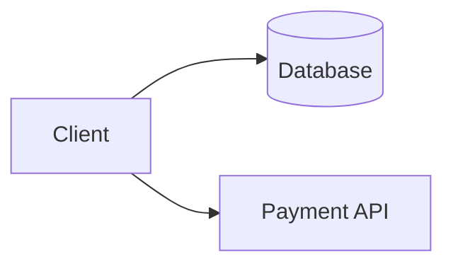
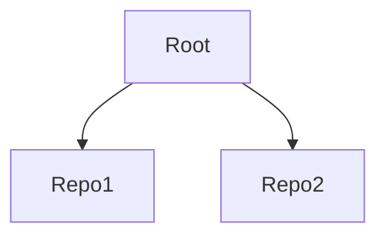

# web-template-astro-profile

Astro template for a personal site: profile, portfolio and blog/knowledge-base. Based on [AstroPaper](https://github.com/satnaing/astro-paper) by Sat Naing (MIT) and extended with a Profile page, a Portfolios section, related-post links and Mermaid diagrams.

Deployment targets:

- **Cloudflare Workers (static assets)**: the target for every site created from this template.
- **GitHub Pages**: used only by this template repo itself, as a live demo at <https://thaonbt.github.io/web-template-astro-profile/>.

The site is fully static and needs no Astro adapter. One codebase builds for both targets: see [`site` and `base`](#site-and-base).

> Looking for the lighter base template that deploys on GitHub Pages? See [web-template-astro](https://github.com/thaonbt/web-template-astro).

## Stack

- [Astro](https://astro.build/) with TypeScript and Tailwind CSS
- Static search with [Pagefind](https://pagefind.app/)
- Markdown and MDX content collections (`posts`, `pages`, `portfolios`)
- Light and dark mode, RSS, sitemap and dynamic OG images
- [Mermaid](https://mermaid.js.org/) diagrams in Markdown (rendered in the browser, loaded only on pages that have a diagram)

## Pages

The header menu order is About, Profile, Portfolios, Posts, Tags, Notes (Archives and Search are icons). **Notes** is an external link to a separate notes site (see [Link to the notes site](#link-to-the-notes-site)).

| Route | Source | How to edit |
| ----- | ------ | ----------- |
| `/` | `src/pages/index.astro` | Intro text lives in the page itself. Featured and Recent posts update automatically |
| `/about` | `src/content/pages/about.md` | Edit the markdown file only. The build fails if `about.md` is missing |
| `/profile` | `src/pages/profile.astro` | Data is hardcoded in the page (see [Profile page](#profile-page)) |
| `/portfolios` | `src/pages/portfolios/index.astro` | One markdown file per project (see [Portfolios](#portfolios)) |
| `/portfolios/grid`, `/portfolios/list` | `src/pages/portfolios/grid.astro`, `list.astro` | Both views are always available, with a toggle on the page |
| `/portfolios/<id>` | `src/pages/portfolios/[...slug]/index.astro` | `<id>` is the markdown file name without extension. Do not name a project `grid` or `list` |
| `/posts`, `/tags`, `/archives`, `/search` | upstream AstroPaper pages | Posts live in `src/content/posts/` (see [Related posts and links](#related-posts-and-links)) |

### Profile page

`src/pages/profile.astro` has three sections: intro with avatar, technical skills and work experience timeline. All sample values are placeholders (`[Your Name]`, `ABC Tech Company`...). To make it yours:

- Replace `src/assets/images/avatar.png` with your own image (same file name, or update the import in `profile.astro`)
- Edit the heading and intro text in the _Profile_ section
- Edit the `skills` array (category and items) at the top of the file
- Edit the `experiences` array (period, role, company, description) at the top of the file

### Portfolios

Each project is a markdown file in `src/content/portfolios/`. Frontmatter schema (defined in `src/content.config.ts`):

| Field | Required | Description |
| ----- | -------- | ----------- |
| `title` | yes | Project name |
| `description` | yes | One-line summary shown on the list page |
| `pubDatetime` | yes | Publication date and time, written **unquoted** in ISO 8601, e.g. `2026-11-02T03:00:00Z`. Astro parses it as a date (`z.date()`), so a quoted value fails the build |
| `modDatetime` | no | Last update date and time, same format. Add it by hand when you change a project |
| `tags` | no | Array of strings, default `[]` |
| `thumbnail` | no | Image path relative to the markdown file, e.g. `../../assets/images/my-project.png`. Shown in the Grid view only |
| `repo` | no | Full URL of the repository. Only fill in for **public** repos |
| `demo` | no | Full URL of a live demo |
| `order` | no | Number, default `100`. Smaller numbers are listed first |

Example `src/content/portfolios/my-project.md`:

```md
---
title: My Project
description: Short summary of what it does
pubDatetime: 2026-11-02T03:00:00Z
modDatetime: 2026-11-10T08:30:00Z # optional
tags: [TypeScript, Astro]
thumbnail: ../../assets/images/my-project.png
repo: https://github.com/<account>/<repo>
order: 1
---

Details, screenshots and lessons learned in markdown.
```

Instead of writing the frontmatter by hand, generate it with the helper script (it sets `pubDatetime` to the current UTC time and validates the URLs and the thumbnail before writing):

```bash
pnpm new-project "My Project" \
  --description "Short summary of what it does" \
  --tags TypeScript,Astro \
  --repo https://github.com/<account>/<repo> \
  --thumbnail my-project.png \
  --order 1
```

| Flag | Description |
| ---- | ----------- |
| `--description` | One-line summary (can be filled in later) |
| `--tags` | Comma-separated list |
| `--repo`, `--demo` | Full URLs, checked before the file is written |
| `--thumbnail` | File name inside `src/assets/images/`, the file must already exist |
| `--order` | Number, default `100` |
| `--dir` | Target folder, default `src/content/portfolios` |

The file name comes from the title (`My Project` becomes `my-project.md`, Vietnamese diacritics are stripped). The script refuses to overwrite an existing file and rejects the reserved names `grid` and `list`. It never writes `modDatetime`: add that line yourself when you update a project.

`thumbnail` is validated by Astro's `image()` helper, so the file must exist (put images in `src/assets/images/`) or the build fails. `repo` and `demo` are validated as URLs, so a value without `https://` fails the build. The detail page shows **Repo** and **Demo** links only when the fields are set.

#### Grid and List views

Both layouts are built from the same data. A **List / Grid** toggle at the top right of the page switches between them (plain links, no JavaScript).

| View | Route | Component | What it shows |
| ---- | ----- | --------- | ------------- |
| Grid | `/portfolios/grid` | `src/components/PortfolioGrid.astro` | Responsive cards (16:9 thumbnail, title, 3-line description, tag chips). The whole card is clickable. A card without `thumbnail` simply has no image |
| List | `/portfolios/list` | `src/components/PortfolioList.astro` | Title, description and tags on one line. Thumbnails are ignored |

Both routes render `src/components/PortfolioPage.astro` with a `view` prop (`"grid"` or `"list"`). That component also owns the toggle and the sorting by `order` (`pubDatetime` and `modDatetime` do not affect the order).

**Default view** (what `/portfolios` and the header menu show): edit `src/pages/portfolios/index.astro` and switch the `view` prop between `"grid"` and `"list"`. To keep only one view, delete the other route file and the unused component, then remove it from the `views` array in `PortfolioPage.astro` so the toggle disappears.

## Link to the notes site

The **Notes** menu item opens a different site (by default the [Quartz](https://quartz.jzhao.xyz/) digital garden from `kb-template-quartz`). It is a plain external link, not a page of this site.

- The address is written directly in `src/components/Header.astro`:

```astro
<li class="col-span-2">
  <a
    href="https://thaonbt.github.io/kb-template-quartz"
    target="_blank"
    rel="noopener noreferrer"
  >
    {t.nav.notes}
  </a>
</li>
```

- The label comes from the `nav.notes` key in `src/i18n/lang/en.ts` (type in `src/i18n/types.ts`). If you add another language file, add `notes` and `related` entries there too, otherwise `astro check` fails.
- Replace the `href` with the address of your own notes site.
- To remove the link, delete the `<li>` in `Header.astro` and the `notes` key in `en.ts` and `types.ts`.

## Related posts and links

A post can show a collapsible **Related** block at the bottom of the article (below the content, above the tags). It lists posts from this site and external links in one expander and is hidden when both fields are empty.

Two optional frontmatter fields on the `posts` collection (defined in `src/content.config.ts`):

| Field | Description |
| ----- | ----------- |
| `relatedPosts` | Array of post ids (a `reference("posts")`): the file path inside `src/content/posts/` without the extension. Drafts are skipped |
| `relatedLinks` | Array of `{ title, url }` for external links. `url` must be a full URL and opens in a new tab |

```md
---
title: "My post"
relatedPosts:
  - another-post
  - sub-folder/yet-another-post
relatedLinks:
  - title: Astro Docs
    url: https://docs.astro.build
---
```

How it is wired:

- `src/components/RelatedLinks.astro` renders the block (an HTML `<details>` element, no JavaScript). The post page passes `relatedPosts` and `relatedLinks` to it, right after the `<article>`
- The label comes from the `post.related` key in `src/i18n/lang/en.ts` (type in `src/i18n/types.ts`)
- To remove the feature, delete `RelatedLinks.astro`, its usage, the two fields in `content.config.ts` and the `related` key in `en.ts` and `types.ts`

To show the block above the content, place `<RelatedLinks ... />` before the `<article>` in the post page.

## Diagrams (Mermaid)

Mermaid diagrams are written as plain text in a fenced code block and rendered in the browser. The `mermaid` library is loaded **only on pages that contain a diagram** (dynamic `import()`).

### Wiring

`mermaid` is already in `package.json`, so `pnpm install` is enough.

| Piece | File | Purpose |
| ----- | ---- | ------- |
| Skip syntax highlighting | `astro.config.ts` | `markdown.syntaxHighlight` must be `{ type: "shiki", excludeLangs: ["mermaid"] }`. Without it Shiki turns the block into a normal code block |
| Render script | `src/scripts/mermaid.ts` | Finds `pre > code.language-mermaid`, replaces it with a `.mermaid` container and calls `mermaid.run()`. Runs on `astro:page-load`, so it works with `ClientRouter` navigation |
| Load the script | `src/layouts/Layout.astro` | `import "@/scripts/mermaid";` in the bundled `<script>` at the end of `<body>`. Do **not** use `<script is:inline>`: inline scripts cannot resolve `import("mermaid")` |
| Colors | `src/styles/global.css` | `--dg-*` CSS variables and `.mermaid ...` rules |

`mermaid.ts` uses `theme: "base"` and `securityLevel: "strict"`. All colors come from `global.css`, so light and dark mode switch instantly without re-rendering.

### Usage

````md

````

Use `flowchart` (not the older `graph`).

### Colors: 4 roles instead of per-diagram styles

Do **not** write `style ... fill:#...` in a diagram. Give each node a role and let `global.css` pick the color. Roles use the Okabe-Ito palette (color-blind safe) and each one also differs by shape or line.

| Role | Color | Shape or line | Suggested meaning |
| ---- | ----- | ------------- | ----------------- |
| `primary` | Blue | Solid | Main component or starting point |
| `data` | Green | Cylinder `[( )]` | Data store |
| `ext` | Orange | Dashed | External or supporting system |
| `risk` | Red-orange | Thick border | Needs attention (security, risk) |
| _(none)_ | Gray | Solid | Ordinary node |

Assign roles with a suffix (`A[Text]:::primary`) or for a group of nodes:

````md

````

Sequence diagrams have their own rules in `global.css`. `mindmap` and `architecture-beta` have no custom CSS yet and render with Mermaid defaults.

To change colors, edit the `--dg-*` variables in `.mermaid` (light) and `[data-theme="dark"] .mermaid` (dark) in `src/styles/global.css`.

## Requirements

- Node.js 22.12 or later (24 recommended)
- pnpm 12.x. The exact version is pinned with `packageManager` in `package.json`. `pnpm-workspace.yaml` uses `allowBuilds`, which older pnpm versions do not understand
- Use **pnpm only**. The repo ships `pnpm-lock.yaml`, so do not run `npm install` or `npm ci`

## Use as a template

1. Click **Use this template** on GitHub to create a new repo (for example `web-<your-name>`).
2. Clone it and install dependencies:

   ```bash
   pnpm install
   ```

3. Edit `astro-paper.config.ts`: `site.url`, `site.title`, `site.description`, `site.author`, social links and `features.editPost.url`. **`site.url` must be a full URL** such as `https://my-site.workers.dev/`, or the build fails with `Invalid URL`.
4. Replace the placeholder content:
   - About page: `src/content/pages/about.md`
   - Profile page: `src/pages/profile.astro` and `src/assets/images/avatar.png`
   - Portfolio entries: `src/content/portfolios/`
   - Posts: add markdown files to `src/content/posts/` (only `.gitkeep` in this template)
   - Notes link: the `href` in `src/components/Header.astro`
5. Set `name` in `wrangler.jsonc` to your own Worker name.
6. Set `CLOUDFLARE_URL` in `deploy.config.ts` to your final Cloudflare URL (see [`site` and `base`](#site-and-base)).
7. Optional: delete `.github/workflows/deploy-github-pages.yml`. It only runs in the template repo itself, so in your repo its jobs are skipped.
8. Remove what you do not need:
   - To drop a page (for example Portfolios), delete its files under `src/pages/` and `src/content/`, remove the collection from `src/content.config.ts` and its entry from the menu in `src/components/Header.astro` (labels are in `src/i18n/lang/en.ts`).
   - To drop Mermaid, remove `src/scripts/mermaid.ts`, its import in `Layout.astro`, the Mermaid block in `src/styles/global.css` and the `excludeLangs` option in `astro.config.ts`, then run `pnpm remove mermaid`.

## `site` and `base`

The two targets need different values: Cloudflare serves the site at the root of its domain, while GitHub Pages serves a project repo at `https://<owner>.github.io/<repo>/`.

| Target | `site.url` | `base` |
| ------ | ---------- | ------ |
| Cloudflare Workers or custom domain | Your final URL (e.g. the `workers.dev` URL) | `/` |
| GitHub Pages (project repo) | `https://<owner>.github.io/` | `/<repo>` |
| GitHub Pages (user repo `<owner>.github.io`) | `https://<owner>.github.io/` | `/` |

Both values come from one file, `deploy.config.ts`, so they cannot drift apart:

- `astro-paper.config.ts` uses `deploy.siteUrl` for `site.url`
- `astro.config.ts` uses `deploy.base` for `base`

The target is chosen by the `DEPLOY_TARGET` environment variable. Only `.github/workflows/deploy-github-pages.yml` sets it (to `github`). Cloudflare builds and local machines leave it unset, so they use the Cloudflare values.

Do not use `GITHUB_ACTIONS` or `NODE_ENV` for this: GitHub Actions sets `GITHUB_ACTIONS=true` in every workflow (including one that deploys to Cloudflare) and `NODE_ENV` is `production` in every build.

**Your only edit** is `CLOUDFLARE_URL` at the top of `deploy.config.ts`. The GitHub values are derived from `GITHUB_REPOSITORY` (`owner/repo`) automatically.

Whenever `base` is not `/`, every internal link must include the prefix. Use `getRelativeLocaleUrl` (from `astro:i18n`) for pages and `getAssetPath` (from `src/utils/withBase.ts`) for files instead of hardcoded paths.

## Commands

| Command | Action |
| ------- | ------ |
| `pnpm install` | Install dependencies |
| `pnpm dev` | Dev server at `http://localhost:4321/` |
| `pnpm build` | Type-check (`astro check`), build to `./dist/` and generate the Pagefind index |
| `pnpm preview` | Serve the production build locally |
| `pnpm lint` | Run ESLint |
| `pnpm format` | Format the code with Prettier (`pnpm format:check` only checks) |
| `pnpm new-post` | Create a new post with valid frontmatter (`src/scripts/new-post.mjs`) |
| `pnpm new-project "Title"` | Create a new portfolio entry with valid frontmatter (see [Portfolios](#portfolios)) |

Search only works after `pnpm build`. In dev mode the search index may be empty.

### Verify a build locally

```bash
pnpm install --frozen-lockfile
rm -rf dist .astro && pnpm build
grep -o 'href="[^"]*css"' dist/index.html   # must start with /_astro/
```

### Verify both targets locally

```bash
# Cloudflare configuration (default)
rm -rf dist .astro && pnpm build
grep -o 'href="[^"]*css"' dist/index.html   # must start with /_astro/

# Simulate the GitHub Pages build
rm -rf dist .astro && DEPLOY_TARGET=github GITHUB_REPOSITORY=your-username/your-repo pnpm build
grep -o 'href="[^"]*css"' dist/index.html   # must start with /your-repo/_astro/
pnpm preview                                # then click through the site under /your-repo/
```

### Docker (optional)

- `docker compose up` starts the dev server on port 4321 (project mounted into the container)
- `Dockerfile` builds the static site and serves `dist` with nginx on port 80

## Deploy to Cloudflare Workers

The site is static, so it is served as Workers static assets. No Astro adapter is needed.

1. In the Cloudflare dashboard, create a Worker from your Git repository.
2. Build settings:
   - Build command: `pnpm run build` (so Pagefind indexing runs after the Astro build)
   - Deploy command: `npx wrangler deploy`
3. Keep a `wrangler.jsonc` at the repo root:

```jsonc
{
  "$schema": "node_modules/wrangler/config-schema.json",
  "name": "my-profile", // must match the Worker name in the Cloudflare dashboard
  "compatibility_date": "2026-10-21",
  "workers_dev": true, // enables the *.workers.dev URL
  "preview_urls": false, // set to true if you want Preview URLs
  "assets": {
    "directory": "./dist"
  }
}
```

4. If the build picks an older pnpm, set the environment variable `PNPM_VERSION` to the version in `packageManager`.
5. Make sure `CLOUDFLARE_URL` in `deploy.config.ts` equals the final URL.

## Deploy to GitHub Pages (template repo only)

This is how the live demo of the template is published. Repos created from the template do not need it.

1. Mark the repo as a template: **Settings > General > Template repository**, or:

   ```bash
   gh repo edit <owner>/<repo> --template
   ```

2. Enable Pages with GitHub Actions as the source: **Settings > Pages > Source: GitHub Actions**, or:

   ```bash
   gh api -X POST repos/<owner>/<repo>/pages -f build_type=workflow
   ```

3. Push to `main`. `.github/workflows/deploy-github-pages.yml` builds with `DEPLOY_TARGET=github` and publishes `dist/`.

The workflow jobs have `if: github.event.repository.is_template`, so they run only while "Template repository" is enabled. A repo created from the template is a normal repo: its jobs show as skipped and Cloudflare deploys it. GitHub Pages on a **private** repo needs a paid GitHub plan, which is another reason to keep the Pages deployment in the public template repo only.

## Common pitfalls

**Build and setup**

- **`[config] Invalid URL` during `astro check`:** `CLOUDFLARE_URL` in `deploy.config.ts` is not a full URL (for example a placeholder like `[Your site URL]` or a missing `https://`). Use `https://<your-worker>.workers.dev/`.
- **`npm ci` or `npm install` misbehaves:** the repo is pnpm-only. Use `pnpm install --frozen-lockfile`. Keep only `pnpm-lock.yaml`, because CI picks the package manager from the lockfile.
- **Build fails offline or behind a proxy:** the build downloads the Google Sans Code font (code blocks and OG images). Without access to Google Fonts, `pnpm build` stops with `Cannot find the font path`.
- **Build fails with "Missing content entry":** `src/content/pages/about.md` was renamed or deleted.

**Cloudflare**

- **Site has no styles and links point to a wrong prefix:** a leftover `base` value. Set `base` to `/` (or remove it), push and hard refresh.
- **Build fails with `packages field missing or empty`:** the build used pnpm 9, which does not understand `allowBuilds`. Pin `packageManager` in `package.json` and set `PNPM_VERSION` on Cloudflare.
- **Deploy fails with `ERR_PNPM_IGNORED_BUILDS: workerd`:** `wrangler.jsonc` is missing, so Wrangler runs autoconfig and installs extra packages. Add the config file above.
- **`No URLs enabled`:** enable `workers.dev` under Settings > Domains & Routes or set `workers_dev: true`.
- **`Failed to match Worker name`:** the `name` in `wrangler.jsonc` differs from the Worker name in the dashboard. Make them identical.

**GitHub Pages**

- **The deploy workflow is skipped:** "Template repository" is not enabled, or you are in a repo created from the template (expected there). Enable it with `gh repo edit <owner>/<repo> --template`.
- **Deploy fails with `HttpError: Not Found`:** Pages is not enabled. Set **Settings > Pages > Source** to **GitHub Actions**.
- **Pages site has no styles and links give 404:** `base` is `/` in a GitHub build. Check that `deploy.config.ts` is used by `astro.config.ts`, and that internal links use `getRelativeLocaleUrl` and `getAssetPath` instead of hardcoded paths.
- **Cloudflare site has no styles and links point to `/<repo>/...`:** `DEPLOY_TARGET=github` is set in the Cloudflare build (workflow or dashboard variables). Remove it there.
- **The build step fails to find pnpm or the right version:** `packageManager` is missing from `package.json`. Pin it to the pnpm version you use.
- **A second workflow also deploys to GitHub Pages:** keep only `deploy-github-pages.yml`. Cloudflare is deployed by its own Git integration, so it needs no workflow.

**Content**

- **A post does not show up:** check `draft` and `pubDatetime` in its frontmatter. Drafts and future-dated posts can be skipped in production builds.
- **The Related block does not show:** it sits at the bottom of the post. Check the key names (`relatedPosts`, `relatedLinks`, case-sensitive): Zod ignores unknown keys silently, so a misspelled key shows nothing and raises no error.
- **Build fails on `relatedPosts`:** an id does not match any file in `src/content/posts/`. The error lists the valid ids.
- **Build fails on `relatedLinks`:** `url` must be a full URL. Link to posts of this site with `relatedPosts` instead.
- **Build fails on a portfolio entry:** check the frontmatter against the schema above. `title`, `description` and `pubDatetime` are required, `repo` and `demo` must be full URLs and `thumbnail` must point to an existing image.
- **`pubDatetime: Required` on a portfolio entry:** the file was created by hand or by an older script and has no `pubDatetime`. Add a line such as `pubDatetime: 2026-11-02T03:00:00Z`, or recreate the entry with `pnpm new-project`.
- **`pubDatetime` or `modDatetime` fails validation although the line exists:** the value is quoted (`"2026-11-02..."`) or is not a valid ISO 8601 date. Write it unquoted, for example `2026-11-02T03:00:00Z`.
- **Thumbnail does not show:** thumbnails only appear in the Grid view. Check which view `/portfolios` uses in `src/pages/portfolios/index.astro`.
- **The Notes menu item opens the template demo:** the `href` in `src/components/Header.astro` still points to `kb-template-quartz`.
- **The Profile page still shows placeholder text:** its content is hardcoded in `src/pages/profile.astro`, not in the markdown collections.

**Mermaid**

- **A block shows as plain code:** `excludeLangs: ["mermaid"]` is missing in `astro.config.ts`, or `src/scripts/mermaid.ts` is not imported in `Layout.astro`. Check the browser console for `Mermaid render failed`.
- **Build fails with `Non-null assertions can only be used in TypeScript files`:** the Mermaid code was pasted into `<script is:inline>`. Keep it in `src/scripts/mermaid.ts`.
- **All nodes are light gray:** nodes have no role, or the diagram still has old `style ... fill:` lines. Remove them and assign roles.
- **A diagram type ignores the colors:** only `flowchart` and `sequenceDiagram` have CSS rules. Other types need their own selectors in `global.css`.

## Credits and license

Based on [AstroPaper](https://github.com/satnaing/astro-paper) by [Sat Naing](https://satnaing.dev/).

Released under the [MIT License](./LICENSE). The original copyright notice is preserved as required.